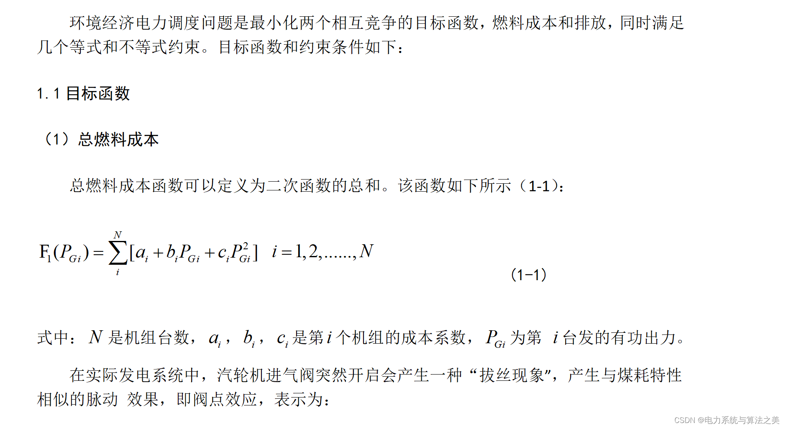
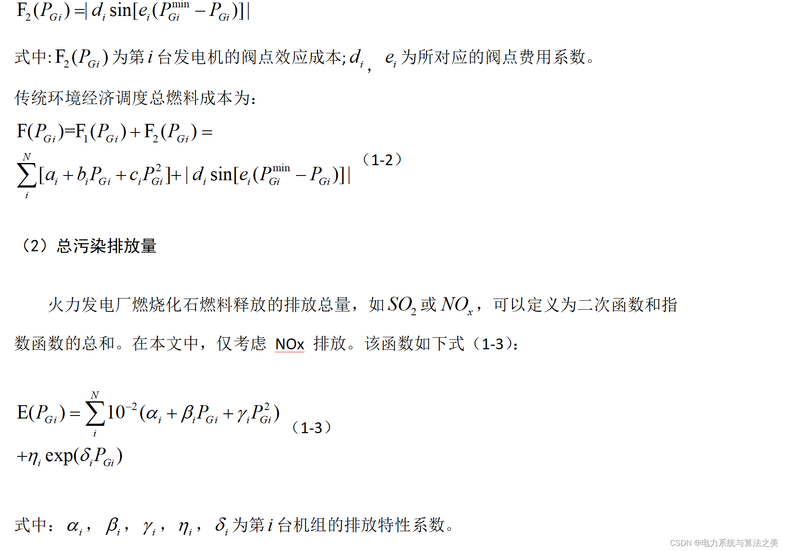
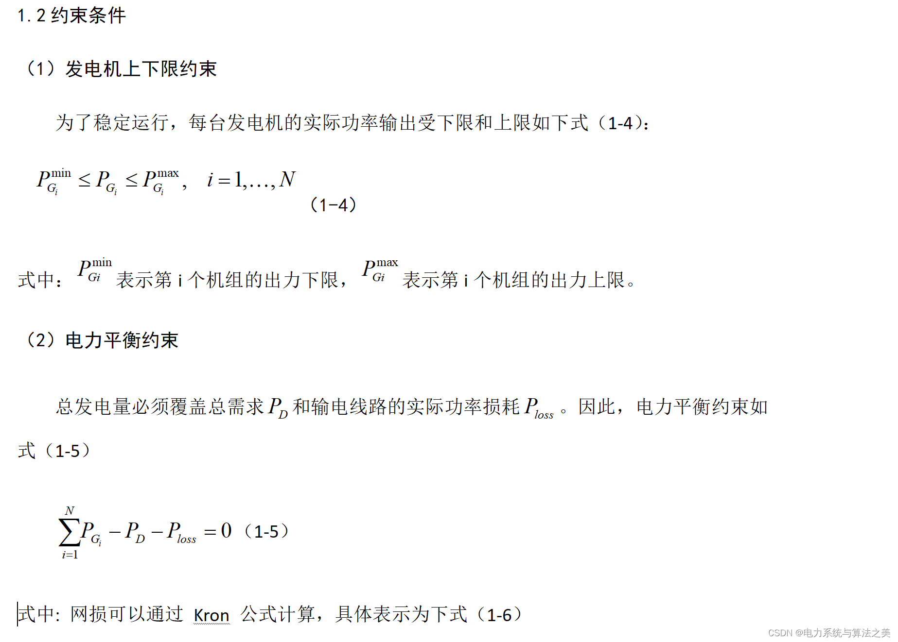
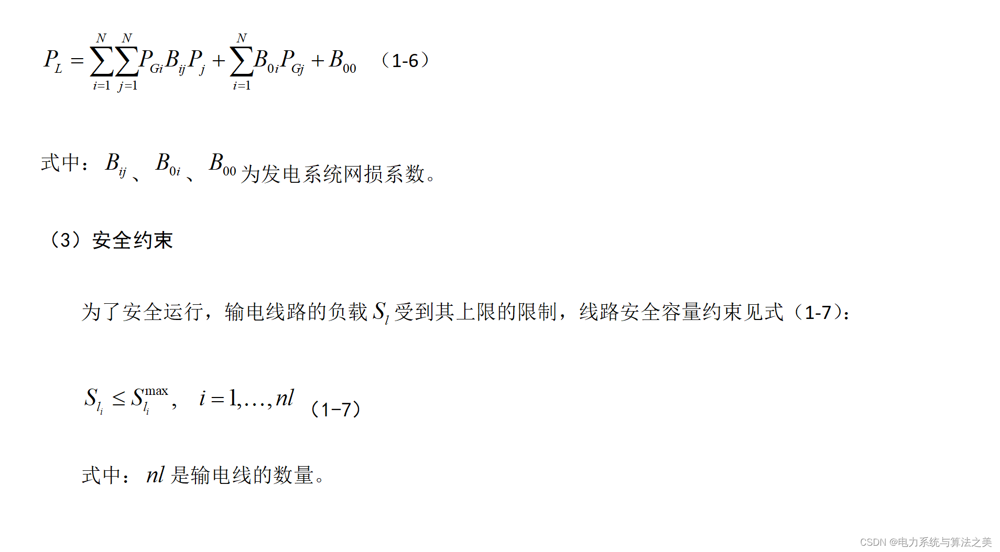
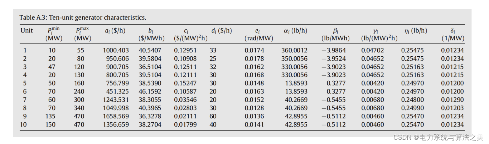
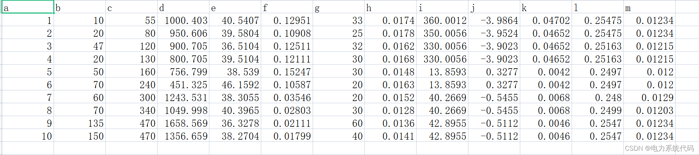
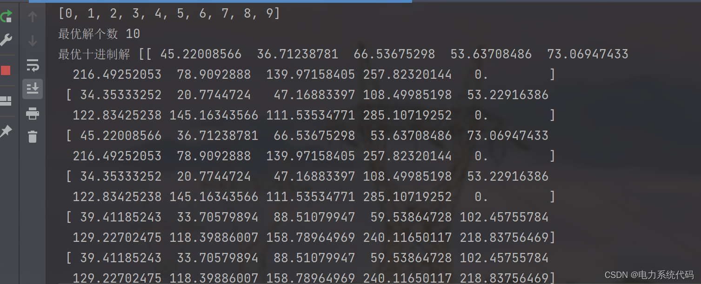
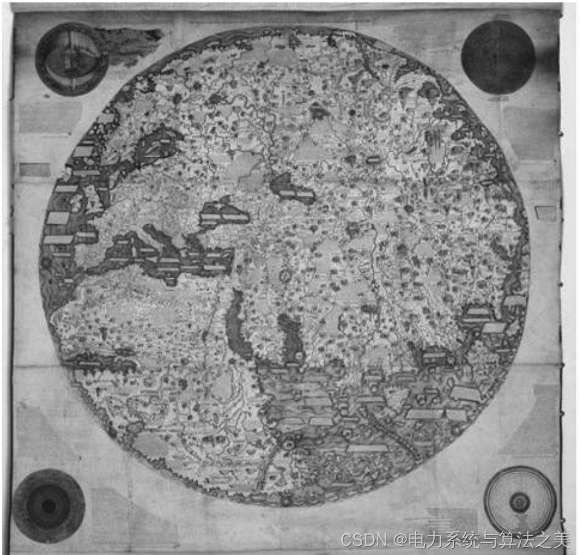

# Multi-objective Genetic Algorithm NSGAII for Solving Environmental Economic Scheduling (Python Code Implementation)

1. Electric Power System Environmental Economic Dispatch Mathematical Model
2. Example - IEEE 10-Node
2.1 Data
2.2 Python Code Learning
3. Additional Knowledge
1. Editing the Electric Power System Environmental Economic Dispatch Mathematical Model
Editing
Editing
Editing
2. Example - IEEE 10-Node
2.1 Data
I have organized the data into a table for easier programming reading and writing:
Editing
2.2 Python Code Learning
This article only showcases part of the code, all codes can be found here:
Multi-objective Genetic Algorithm NSGAII has a wide range of applications in power system multi-objective problems. As long as you replace the objective function and constraints in the text with your own, it will work.
#========Import third-party library=============\nimport numpy as np\nimport pandas as pd\nimport matplotlib.pyplot as plt\nimport matplotlib as mpl\n\nmpl.rcParams['font.sans-serif'] = ['SimHei']  # Specify the default font\nmpl.rcParams['axes.unicode_minus'] = False  # Solving the issue of negative signs in image saving.'-'Displaying as squares\nimport matplotlib;\n\nmatplotlib.use('TkAgg')\nfrom tqdm import tqdm  # Progress bar settings\n\n# ========Import data=============\n\n# ~~~~~~~~~~~~~~~~~~~~~Reading files~~~~~~~~~~~~~~~~~~~~~~\nfile=pd.read_csv('IEEE10.csv')#Unit parameters\n#B=pd.read_csv('B10.csv')\n#B=np.reshape()\nB=np.array([[0.000049, 0.000014\t,0.000015,\t0.000015,\t0.000016,\t0.000017\t,0.000017,\t0.000018\t,0.000019,\t0.00002],\n[0.000014,\t0.000045,\t0.000016,\t0.000016,\t0.000017\t,0.000015,\t0.000015\t,0.000016\t,0.000018,\t0.000018],\n[0.000015,\t0.000016,\t0.000039,\t0.00001\t,0.000012,\t0.000012\t,0.000014,\t0.000014,\t0.000016,\t0.000016],\n[0.000015,\t0.000016,\t0.00001,\t0.00004,\t0.000014\t,0.00001\t,0.000011,\t0.000012,\t0.000014,\t0.000015],\n[0.000016,\t0.000017,\t0.000012,\t0.000014,\t0.000035,\t0.000011,\t0.000013,\t0.000013,\t0.000015,\t0.000016],\n[0.000017,\t0.000015,\t0.000012,\t0.00001,\t0.000011\t,0.000036,\t0.000012,\t0.000012,\t0.000014,\t0.000015],\n[0.000017\t,0.000015\t,0.000014,\t0.000011,\t0.000013,\t0.000012,\t0.000038,\t0.000016,\t0.000016,\t0.000018],\n[0.000018\t,0.000016,\t0.000014,\t0.000012,\t0.000013,\t0.000012,\t0.000016\t,0.00004,\t0.000015,\t0.000016],\n[0.000019\t,0.000018\t,0.000016,\t0.000014,\t0.000015\t,0.000014\t,0.000016,\t0.000015,\t0.000042\t,0.000019],\n[0.00002,\t0.000018\t,0.000016\t,0.000015,\t0.000016,\t0.000015,\t0.000018\t,0.000016,\t0.000019\t,0.000044]])\n\nP_max = file['b']  #Crew limit\nP_min = file['c']  # #Minimum limit\n\n\n# ~~~~~~~~~~~~~~~~~Unit characteristic coefficient~~~~~~~~~~~~~~~~~~~~~~~~·\nai = file['d']\nbi=file['e']\nci=file['f']\ndi=file['g']\nei=file['h']\n\n# ~~~~~~~Emission characteristic coefficient~~~~~~~~~~~~~~~~·\nali=file['g']\nbeti=file['h']\ngari=file['i']\neti=file['l']\ndali=file['m']\n\n# ======Multi-objective optimization algorithms can only solve the solution for a single moment.===============\nclass GaMultiobjective(object):\n    def __init__(self, Pload1, P_max, P_min, ai, bi, ci, di, ei, ali, beti, gari, eti, dali):\n        self.Pload1 = Pload1  # Load\n        self.P_max = P_max  # Crew limit\n        self.P_min = P_min  # Minimum limit\n        self.ai = ai\n        self.bi = bi\n        self.ci = ci\n        self.di = di\n        self.ei = ei\n        self.ali = ali\n        self.beti = beti\n        self.gari = gari\n        self.eti = eti\n        self.dali = dali\n\n    # ===Initialize the population====\n    def Initialize(self):\n        X = np.zeros((self.NP, 10))  # Initialize the population, 10Represents the output of a unit\n        for n in range(self.NP):  # Traverse every particle\n            X[n, 0] = np.random.uniform(10, 55, 1)[0]  # G1\n            X[n, 1] = np.random.uniform(20, 80, 1)[0]  # G2\n            X[n, 2] = np.random.uniform(47, 120, 1)[0]  # G3\n            X[n, 3] = np.random.uniform(20, 130, 1)[0]  # G4\n            X[n, 4] = np.random.uniform(50, 160, 1)[0]  # G5\n            X[n, 5] = np.random.uniform(70, 240, 1)[0]  # G6\n            X[n, 6] = np.random.uniform(60, 300, 1)[0]  # G7\n            X[n, 7] = np.random.uniform(70, 340, 1)[0]  # G8\n            X[n, 8] = np.random.uniform(130, 470, 1)[0]  # G9\n            X[n, 9] = np.random.uniform(150, 470, 1)[0]  # G10\n        return X\n\n    # ==========Define the objective function and the corresponding penalty term.=============\n\n    # ===Define a function1 Objective function1: System operational costs===\n    def function1(self, X1):\n        """\n        Individual objective function\n        :param X1: (Individual[G1, G2, G3, G4, G5, G6,G7,G8,G9,G10]\n        :return: Function1Objective function value\n        """\n        SUMCOST = []  # Total cost of storage\n        for i in range (9):  # Traverse each unit,PythonFrom0Start indexing, 0-9: 10Turbine unit\n            cost = self.ci[i] * X1[i] * X1[i] + self.bi[i]* X1[i] +self.ai[i]+\\n                   np.abs(self.di[i]*np.sin(ei[i]*(self.P_min[i]-X1[i]))) #Consider the valve effect\n            SUMCOST.append(cost)\n        return np.sum(SUMCOST)\n\n    # ====Define a function2 Total pollution emission====\n    def function2(self, X1):\n        """\n        Individual objective function\n        :param X1: (Individual[G1, G2, G3, G4, G5, G6,G7,G8,G9,G10]\n        :return: Function2Objective function value\n        """\n        emission=[] #Total pollution emission\n        for i in range(9):\n            e=self.ali[i]+self.beti[i]*X1[i]+self.gari[i]*X1[i]*X1[i]+self.eti[i]*np.exp(self.dali[i]*X1[i])\n            emission.append(e)\n        return np.sum(emission)\n\n    # ===Corresponding constraint - Load balance constraint(This examplecalc_e () Not working, the load balance constraint has been resolved through other means.)===\n    def calc_e(self, X1):\n        """\n    Function1 Corresponding individual sanction item\n    :param X1: (Individual[G1, G2, G3, G4, G5, G6,G7,G8,G9,G10]\n    :return:\n    """\n        Ploss=0\n        for i in range(9):\n            for j in range(9):\n                Ploss+=X1[i]*B[i][j]*X1[j]\n        # cost=np.abs(X1[0]+X1[1]+X1[2]+X1[3]+X1[4]+X1[5]+X1[6]+X1[7]+X1[8]+X1[9]-np.sum(Ploss)-self.Pload1)\n        # return cost\n        return max(0,abs(sum(X1)-Ploss-Pload1-0.1))\n  
Editor
3. Expanded Knowledge
The mindset of exploration and conquest can be clearly seen in the evolution of the world map. Before the advent of modern history, many cultures had their own world maps. Of course, at that time, no one truly knew what the entire world looked like. People on the Asian and African continents were completely unaware of the Americas, and the culture there was also unaware of the situation on the Asian and African continents. However, when encountering unfamiliar regions, not a single blank spot was left on the map, or it was filled with imagined monsters and wonders. These maps did not leave any empty spaces, making people feel as if the whole world was within their grasp.
In the 15th and 16th centuries, European world maps began to show large blank areas. This can be seen as a development in scientific attitudes and motives for European imperialism. The blank areas on the maps can be considered a significant breakthrough in psychology and thought, clearly indicating that Europeans were willing to acknowledge that they still knew very little about most parts of the world.
Editor
Figure 1: A European world map from 1459. It appears detailed, even though the South Africa region, which Europeans were completely unaware of at the time, is densely populated with information.
In 1492, Columbus set sail westward from Spain, hoping to find a new route to East Asia. Columbus still believed in the old world map, thinking that the whole world was laid out before him. Columbus calculated that Japan should be about 7,000 kilometers west of Spain based on the old map. However, the actual distance from Spain to East Asia exceeded two hundred thousand kilometers, and there was also an unknown American continent in between. On October 12, 1492, around 2 a.m., Columbus's crew made their first contact with this unknown continent. Juan Rodriguez Bermejo, a lookout on Pinta, saw the present Bahamas from the mast, shouting excitedly: "There's land! There's land!"
Columbus believed that the small island was located in East Asia and belonged to the "Indies" (Indian lands, which today includes India, the Indochina peninsula, and the East Indies), so he referred to the locals as "Indians." This is why the American natives are also called "Indians." Until his death, Columbus did not consider himself to have made a significant mistake. Whether for him or many contemporary people, claiming to have discovered an entirely unknown continent is utterly improbable. After all, for thousands of years, whether it was great thinkers and scholars, or even the Bible, which is considered unattainably accurate, only knew about Europe, Africa, and Asia. How could they possibly be wrong? Could the Bible have missed out on half of the world, leaving nothing at all?This situation is reminiscent of the Apollo 11 mission to the moon in 1969, where it was unexpectedly discovered that there was another moon not seen by anyone. It's because Columbus refused to acknowledge his ignorance that we can say he remained a medieval person, convinced that he already knew everything about the world, so even with such significant discoveries, he couldn't convince him.
​  

## Images

<!-- PAYMENT_BLOCK -->

## Get this dataset

- Payment link (Stripe): [Buy now](https://buy.stripe.com/3cs8yP7sY87d0vu9AB)
- Payment QR code: 

<!-- /PAYMENT_BLOCK -->
